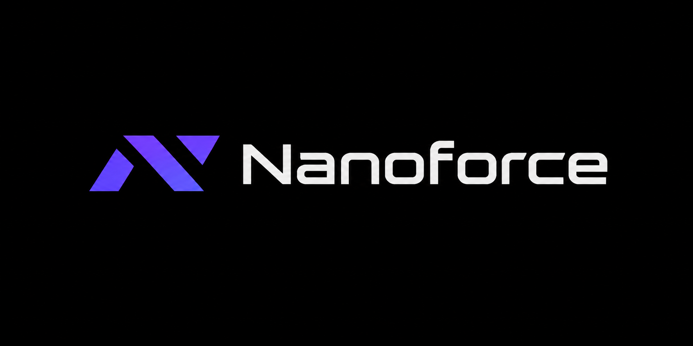

  

A game engine written from scratch: a playground for Vulkan, DirectX and OpenGL, aiming at a Nanite-like renderer one day.

## Requirements

- Windows, Visual Studio 2026 (MSVC)
- CMake 3.25+
- Python 3, Conan 2
- clang-format (for formatting)

## Build

| Script | Action |
| --- | --- |
| `Automation/build_debug.bat` | Build Debug |
| `Automation/build_release.bat` | Build Release |
| `Automation/clean.bat` | Remove `Build/` |
| `Automation/format_all_files.bat` | Format all sources |

## License

[MIT](LICENSE)
